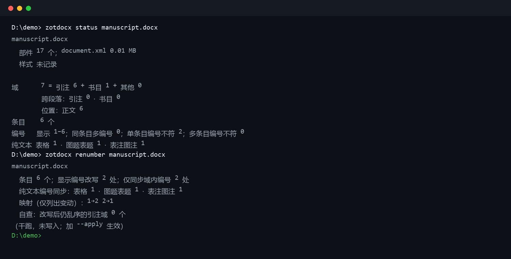

# zotdocx

[](https://github.com/HbS66-pro/zotdocx/actions/workflows/tests.yml)

[English](README.md) | **中文**

修复 Word 文档中 Zotero 引注域的命令行工具。只处理 `.docx` 内的引用域，不修改 Zotero 文献库，不重新排版。



## 处理的问题

- 引注域跨段落，域尾落在下一段
- 域内编号与页面显示的编号不一致
- 编号顺序与实际引用顺序不符
- 正文中的纯文本引用（`[3]`、`[12,13]`）未上宏
- 引用域指向的条目已从文献库删除（断链）
- Zotero 刷新时报「无法删除范围」

## 命令

| 命令 | 功能 |
|---|---|
| `status` | 检查域结构、条目、编号与纯文本引用分布 |
| `heal` | 修复跨段落引注域，对齐域内编号与显示编号 |
| `renumber` | 按首次引用顺序重排编号，同步表格、图题、表注中的纯文本数字 |
| `lift` | 将正文中的纯文本引用补为活域 |
| `repair` | 按 item key 或题名重新连接断链引用 |
| `patch` | 检查或重打 Zotero `omni.ja` 补丁 |

## 安装

```bash
python -m pip install -e .
```

需要 Python 3.9 及以上，依赖 `lxml`。

## 使用

状态检查为只读操作：

```bash
zotdocx status 稿件.docx --zotero-db <zotero.sqlite 路径>
```

```
稿件.docx
  域      115 = 引注 114 + 书目 1 + 其他 0
  条目    76 个
  编号    显示 1–76；同条目多编号 0；单条目编号不符 2
  纯文本 表格 27 · 表注图注 5 · 参考文献表 75
```

存在未通过的检查项时退出码为 1，无问题时为 0。

写入操作默认只做检查，不落盘：

```bash
zotdocx heal     稿件.docx            # 输出将要修改的内容
zotdocx heal     稿件.docx --apply    # 写入，原文件备份为 *.bak_<时间戳>
zotdocx renumber 稿件.docx --apply
zotdocx lift     稿件.docx --apply --out 新文件.docx
```

## 处理范围

- 仅替换 docx 包内的 `word/document.xml`，其他部件保持不变。
- 表格、图题、表注中的编号保持纯文本，`renumber` 只同步数字，不转为活域。
- 图题表题、表注、参考文献标题同时识别中英文写法（图 / 表 / 注 / 参考文献，Table / Figure / Note / References）。
- 文献库只读，查询前复制到临时目录。
- 不修改正文文字，不排版，不做定稿处理。

## 限制

- 仅支持数字型 CSL 样式（如 GB/T 7714、IEEE、Nature、Vancouver）。著者-出版年样式（APA、Harvard）没有编号可排，`renumber` 与 `lift` 不适用。
- 仅在 Windows 与 Word 环境验证。
- 编号被拆分为多个 run 时不处理，列在输出中。
- `repair` 仅依据 item key 与完整题名匹配，无法匹配时报告，不作推测。
- `patch` 需要自行提供修补后的 `integration.js`。

## 测试

```bash
python tests/run_all.py
```

测试使用 `tests/make_fixture.py` 生成的合成文档（中英文各一份），不含真实论文或文献库内容。

## 许可

MIT 协议，见 [LICENSE](LICENSE)。
